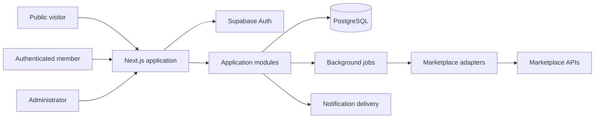
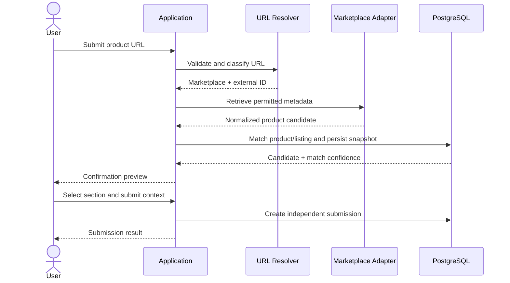

# Architecture

## Direction

Good Finds starts as a modular monolith: one application and one primary relational database, with explicit internal module boundaries. This keeps deployment and data consistency simple while allowing domain code to remain organized.

## Logical context

The diagram is logical, not a deployed topology. Exact hosting, job runner, and provider choices remain subject to validation.

## Module boundaries

| Module | Owns |
|---|---|
| Identity | Profiles, sessions integration, invitations, registration policy |
| Catalog | Canonical products, variants, product identity |
| Marketplace | Marketplace accounts/listings, adapter contracts, metadata snapshots |
| Submissions | Gems/Avoid/Wishlist entries and reasons |
| Feedback | Ratings, reviews, review provenance |
| Verdicts | Aggregation rules and computed community summary |
| Discussions | Wishlist threads and replies |
| Moderation | Reports, moderation actions, audit events |
| Notifications | User-facing notification records and delivery |
| Administration | Platform configuration and operational controls |

Modules may share database infrastructure, but mutations should occur through clear application/service boundaries. Avoid circular module dependencies.

## Key boundaries

1. Canonical product identity is separate from external marketplace listing identity.
2. User submission is separate from product and may reference a product in a category.
3. Marketplace ratings are external data and never enter Good Finds community aggregates.
4. Wishlist discussion does not automatically become a review or rating.
5. Review provenance is explicit and honest.
6. Background provider work is decoupled from public reads.
7. Authorization is checked server-side and reinforced with database policies.

## Data flow: product submission

This is a conceptual flow. The final design must specify whether candidate metadata is persisted before confirmation, how retries work, and how duplicate submissions are handled.

## Cross-cutting requirements

- Input validation and output encoding.
- SSRF-safe URL retrieval.
- Database migrations and policy tests.
- Audit events for privileged actions.
- Idempotency for external ingestion and background jobs.
- Structured logs and error correlation.
- Backups and restore testing.

## Open design work

Track unresolved decisions in [ADR register](../adr/README.md) and GitHub issues. Do not treat this initial architecture as implementation-ready where decisions remain open.
