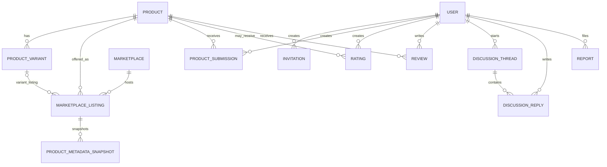

# Domain Model — Initial

This is a conceptual model to guide schema design. It is not a final migration specification. Resolve the linked domain questions before implementing constraints.

## Core entities

| Entity | Responsibility |
|---|---|
| User/Profile | Public identity and account status |
| Invitation | Single-use, expiring registration grant |
| Product | Canonical product/model identity |
| ProductVariant | Materially distinct purchasable configuration |
| Marketplace | External marketplace/provider identity |
| MarketplaceListing | External catalog/offer record for a product or variant |
| ProductMetadataSnapshot | Provider-sourced metadata at a point in time |
| ProductSubmission | A user's Gems/Avoid/Wishlist contribution |
| SubmissionReason | Controlled reason selected for a submission |
| Rating | One active rating per user per defined rating subject |
| RatingRevision | Historical rating changes, if retained |
| Review | User-written experience or opinion |
| ReviewProvenance | Owner experience, community opinion, or verified purchase |
| DiscussionThread | Wishlist discussion topic |
| DiscussionReply | Reply within a thread |
| Report | User-submitted moderation report |
| ModerationAction | Auditable hide/remove/restore/suspend action |
| PlatformSetting | Registration and operational configuration |
| Notification | Notification state and target |
| PriceObservation | Permitted historical price observation |

## Relationship sketch

The rating/review relationships shown at product level are provisional. Variant-specific subject semantics must be decided before schema constraints are finalized.

## Important invariants

1. A canonical product is not identified solely by its marketplace URL.
2. A marketplace listing is unique within its marketplace/external identifier scope, subject to provider semantics.
3. Multiple users can submit one product independently.
4. A product may have submissions in more than one category.
5. Submission category and original author are preserved.
6. A rating has one active value per user and rating subject.
7. External marketplace ratings never contribute to the Good Finds rating.
8. Wishlist threads do not become ownership reviews.
9. A review provenance label must match evidence actually collected.
10. Deleting/deactivating a listing does not cascade-delete product community history.
11. Product merge/split operations must preserve references and audit history.
12. Metadata snapshots retain source and retrieval timestamps.

## Open questions

- What makes two marketplace records the same canonical product?
- Which attributes define a distinct variant?
- Are ratings product-wide, variant-specific, or both?
- Can one user create multiple submissions for the same product/category?
- Can a submission be moved to a different category, or must a correction create a new record?
- Which metadata fields can be stored and displayed under provider terms?
- What is the retention/deletion behavior for user content after account deletion?

See GitHub issues for domain decision work before database implementation.
